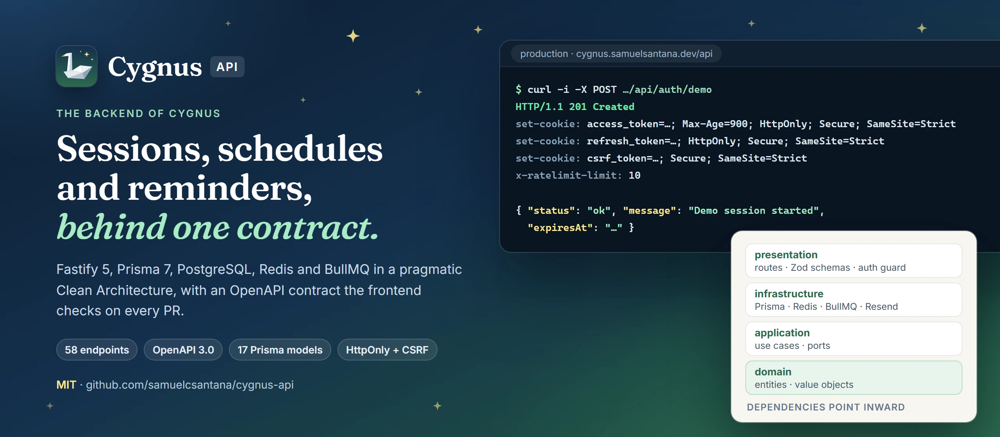
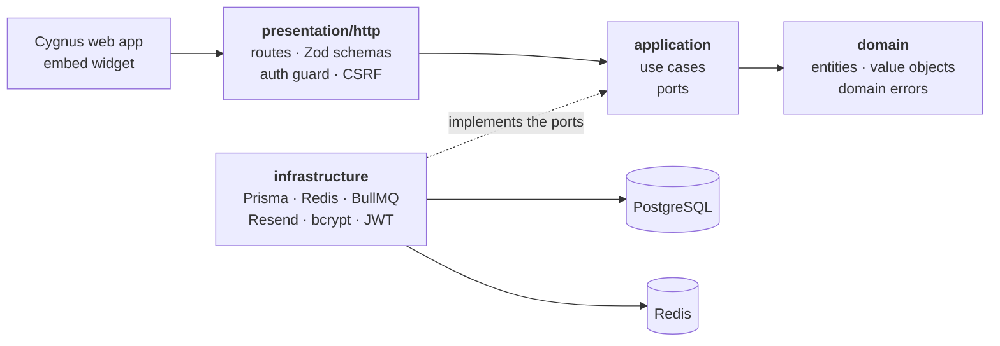
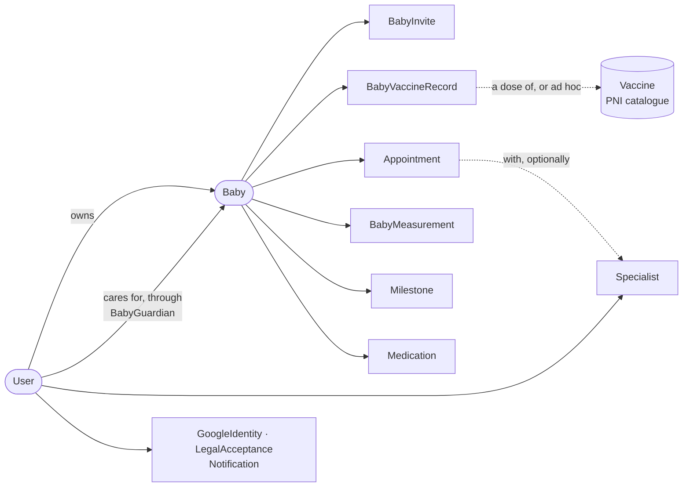

<a href="https://github.com/samuelcsantana/cygnus-api"></a>

<p align="center">
  <a href="https://cygnus.samuelsantana.dev"><b>Live application</b></a> (try the demo, no sign-up) ·
  <a href="https://github.com/samuelcsantana/cygnus">Frontend repository</a> ·
  <a href="openapi.json">OpenAPI contract</a> ·
  <a href="https://samuelcsantana.github.io/cygnus-api/">Coverage report</a>
</p>

<p align="center">
  <a href="https://github.com/samuelcsantana/cygnus-api/actions/workflows/ci.yml"></a>
  <a href="https://github.com/samuelcsantana/cygnus-api/actions/workflows/tests.yml"></a>
  <a href="https://github.com/samuelcsantana/cygnus-api/deployments"></a>
  <a href="https://github.com/samuelcsantana/cygnus-api/actions/workflows/security.yml"></a>
  <a href="https://samuelcsantana.github.io/cygnus-api/"></a>
  <br>
  <a href="https://cygnus.samuelsantana.dev"></a>
  <a href="openapi.json"></a>
  <a href="https://github.com/samuelcsantana/cygnus-api/releases/latest"></a>
  <a href="LICENSE"></a>
  <br>
  
  
  
  
  
  
  
</p>

# Cygnus API

The backend of [Cygnus](https://github.com/samuelcsantana/cygnus), a mobile-first app where
parents keep their children's health record: Brazil's PNI vaccine schedule, appointments, growth,
developmental milestones, medications, professionals and health plans, shared with every person who
helps care.

It serves the Cygnus web app and one public endpoint, the PNI schedule, which any website can show
through the app's embeddable widget. Fastify 5 and strict TypeScript, Prisma 7 on PostgreSQL, Redis
and BullMQ, in a pragmatic Clean Architecture. Every route is described by Zod schemas, and those
schemas produce the [OpenAPI contract](openapi.json) that the frontend checks in its own CI.

Cygnus organizes information. It does not replace advice from healthcare professionals.

## What is worth reading here

The decisions below are the ones a reviewer would ask about. Each names the file where it lives.

- **One contract, generated from the code.** The Zod schema on each route validates the request and
  the response and becomes the OpenAPI document (`fastify-type-provider-zod`). `openapi.json` is
  committed, and CI regenerates it and fails on any difference, so the published contract cannot
  drift from the routes. The frontend's CI compares its own schemas with that file
  ([`scripts/generate-openapi.ts`](scripts/generate-openapi.ts)).
- **Sessions that can actually be ended.** The access token (15 minutes) and the refresh token
  (7 days) are HttpOnly, `Secure`, `SameSite=Strict` cookies, never JSON. A refresh rotates, and its
  `jti` is revoked in Redis. A password reset increments `users.session_version`, which kills every
  refresh token at once. It is a counter, not a timestamp: `iat` has one-second resolution, so a time
  cutoff would spare the tokens issued in the very second of the reset
  ([`refresh-user-session.use-case.ts`](src/application/user/refresh-user-session.use-case.ts)).
- **Sign-in flows that never tell who has an account.** A request for a sign-in code or a password
  reset answers 200 for every address, registered or not, delivered or not. A wrong, expired, spent
  or unknown code gets the same 401 with the same message. The six-digit codes are stored as an
  HMAC, and one Lua script counts the attempt, enforces the budget of 5 and consumes the code, so
  those steps cannot interleave. Codes live 10 minutes, and an address can ask for 5 every
  15 minutes.
- **A demo that cannot become a real account.** `POST /auth/demo` creates a disposable account with a
  sample family dated relative to today, signs the caller in, and answers 201; each IP may open 10 an
  hour. `demo_expires_at` is written on create and never on update, so no profile edit makes a demo
  permanent. Demo addresses use the `.invalid` domain, which the e-mail service drops, and a BullMQ
  job deletes expired demos every hour ([`src/application/demo/`](src/application/demo)).
- **A public endpoint that cannot carry a session.** `/public/*` answers
  `Access-Control-Allow-Origin: *` without credentials, and everything else answers one origin with
  credentials. Browsers refuse a wildcard origin with credentials, which is exactly what keeps the
  public prefix from ever reading a cookie. One CORS delegate and one exported prefix keep the two
  halves in step ([`build-app.ts`](src/infrastructure/http/build-app.ts)).
- **Reminders that survive a failure.** The daily reminder sweep retries 5 times with exponential
  backoff from 30 seconds, then lands in a dead-letter queue. Retrying is safe because the consumer
  is idempotent: a notification is created once per trigger. Redis is pinned to `noeviction`, so a
  dead letter cannot be evicted under memory pressure ([`src/infrastructure/queue/`](src/infrastructure/queue)).
- **Deploys that migrate the database first.** The container runs `prisma migrate deploy` before the
  server starts. Neon's pooler can strand the migration's advisory lock, so
  [`scripts/start.sh`](scripts/start.sh) retries 8 times, 15 seconds apart, and the CLI uses the
  direct host when `DIRECT_DATABASE_URL` is set.

## Architecture



Dependencies point inward: the domain imports nothing, use cases depend on interfaces, and the
infrastructure implements them. Plain `*.instance.ts` modules wire the pieces together, without a
dependency injection container.

| Path | What lives there |
| --- | --- |
| `src/domain/` | Entities, value objects and domain errors |
| `src/application/` | Use cases and the contracts they depend on |
| `src/infrastructure/` | Prisma repositories, Redis, BullMQ queues and workers, e-mail, the Fastify app |
| `src/presentation/http/` | Routes (one file per feature), Zod schemas, auth plugins |
| `src/shared/` | Configuration, logging and utilities |
| `prisma/` | Schema, migrations and the vaccine catalogue seed |
| `tests/` | Unit tests with hand-written fakes, integration tests on real PostgreSQL and Redis |

`src/generated/` holds the Prisma client. It is build output: ignored by git and never edited.

## Data model

How the 17 Prisma models hang together, around the child. The join tables for shared professionals
and the audit log are left out.



A vaccine record without a catalogue dose is an ad hoc vaccine, given outside the PNI schedule. An
appointment keeps the doctor's name typed on the day when its professional is deleted: a health
record does not lose information because somebody cleaned a list.

## Endpoints

58 operations, all in [`openapi.json`](openapi.json) with every status they can return.

| Area | Operations | Examples |
| --- | ---: | --- |
| Auth | 13 | register, login, refresh, `me`, demo, sign-in codes, password reset, Google |
| Users | 4 | update profile, export data, confirm and delete the account |
| Babies | 5 | create, list, read, update, delete a child |
| Vaccines | 5 | the child's schedule, apply a dose, ad hoc vaccines |
| Appointments | 6 | CRUD per child, and the list of specialties |
| Specialists | 4 | the family's professionals |
| Medications | 4 | CRUD per child |
| Milestones | 5 | CRUD per child |
| Guardians | 5 | invite, read and redeem an invite, list and remove guardians |
| Notifications | 2 | list, mark as read |
| Legal | 2 | read and record acceptance of the terms |
| Uploads, Public, Health | 3 | a milestone photo; the PNI schedule for the widget; the health check |

Swagger UI runs only under `npm run dev`, at `/docs`. In production, and in the Docker stack, which
runs the production image, `/docs` answers 404: the UI is a full map of the API for no end user, so
the committed file is how the contract is published.

## Running locally

Use Node.js 24 and npm. Copy [`.env.example`](.env.example) to `.env` and fill in local values; keep
environment files out of git.

```bash
npm ci
npm run prisma:generate
docker compose up -d postgres redis
npm run prisma:migrate
npm run prisma:seed
npm run dev        # http://localhost:3005, Swagger UI at /docs
```

Or run the whole stack in Docker:

```bash
docker compose up -d --build
```

| Service | Host port |
| --- | --- |
| API | 3005 |
| PostgreSQL | 5433 |
| Redis | 6379 |

The container is the production image: it applies pending migrations on start, serves no `/docs`,
and needs a rebuild after every source change. Compose sets `SECURE_COOKIES=false` because it runs
over plain HTTP; without it the browser drops the `Secure` cookies and every request after the login
is a 401. Compose does not start the frontend, which lives at `http://localhost:4205` (see the
[frontend repository](https://github.com/samuelcsantana/cygnus)).

[Google sign-in setup](GOOGLE_AUTH.md) covers the credentials, the callback URLs and how a Google
identity is linked to an existing account.

## Tests and coverage

Integration tests run against a real PostgreSQL and a real Redis, through Fastify's `inject()`, and
delete data between tests. Point them only at a dedicated test database. Copy
[`.env.test.example`](.env.test.example) to `.env.test`, create `cygnus_db_test`, and use Redis
logical database `/1`.

```bash
npm run prisma:generate
npm run test:migrate      # prisma db push, for the throwaway test database only
npm test
npm run test:coverage
```

Spec files run one at a time, because they share one database and one file's cleanup would race
another's writes. Application databases only ever change through committed migrations.

The [coverage report](https://samuelcsantana.github.io/cygnus-api/) combines the unit and
integration suites over every authored file in `src/`, imported by a test or not, and excludes the
generated Prisma client. CI fails below a floor (97% of lines, statements and functions, 92% of
branches) set in `vitest.config.mts`. Most of what stays uncovered is `src/main.ts`, the process
bootstrap (listen, signal handlers, exit), which only a running server exercises. Coverage is not a
security claim.

## Commands and CI

| Command | Purpose |
| --- | --- |
| `npm run dev` | Development server with reload and Swagger UI |
| `npm run build` | Typecheck and compile the app and the seed |
| `npm run typecheck` | Typecheck the tests together with the code they test |
| `npm start` | Run the compiled app |
| `npm test` / `npm run test:coverage` | Unit and integration tests / with V8 coverage |
| `npm run openapi:generate` | Regenerate `openapi.json` after a route or schema change |
| `npm run prisma:migrate` | Create and apply a development migration |
| `npm run prisma:migrate:deploy` | Apply committed migrations |
| `npm run prisma:seed` | Seed the vaccine catalogue |
| `npm run prisma:studio` | Open Prisma Studio |

Three workflows run on every pull request: `ci.yml` (build, a typecheck of the tests together with
the code, and the `openapi.json` drift check), `tests.yml` (the suites against PostgreSQL and Redis
service containers, then the coverage report to GitHub Pages from `main`) and `security.yml`
(`npm audit`, also every Monday). There is no lint script yet.

## Deployment and known limits

A merge to `main` deploys to Render (`render.yaml`), and the container migrates the production
database before it starts. PostgreSQL is on Neon and Redis is a Render Key Value instance. Browsers
reach the API through the frontend's `/api/*` rewrite: Render sells custom domains only on paid
plans, and `SameSite=Strict` cookies would not travel to a cross-site host.

What the current hosting does not do:

- The free Render instance sleeps when idle and takes about a minute to wake. The reminder worker
  runs in the same process, so the 08:00 sweep is not dependable until the instance is paid.
- Milestone photos are served from public URLs; only uploading requires a session. Their durability
  depends on the host's storage.
- Deleting an account does not promise immediate removal from logs or provider backups, and the
  data export is partial. The [Privacy Policy](https://cygnus.samuelsantana.dev/privacidade) and the
  [Terms of Use](https://cygnus.samuelsantana.dev/termos) describe what the service does.

The API and the frontend are versioned independently.

## License

[MIT](LICENSE), © 2026 Samuel Santana. Dependencies keep their own licenses.

Built by Samuel Santana: [samuel.ssa89@gmail.com](mailto:samuel.ssa89@gmail.com).
